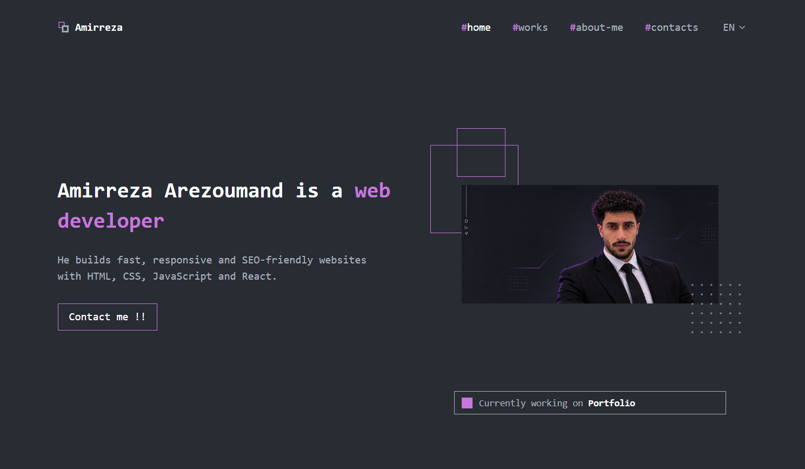
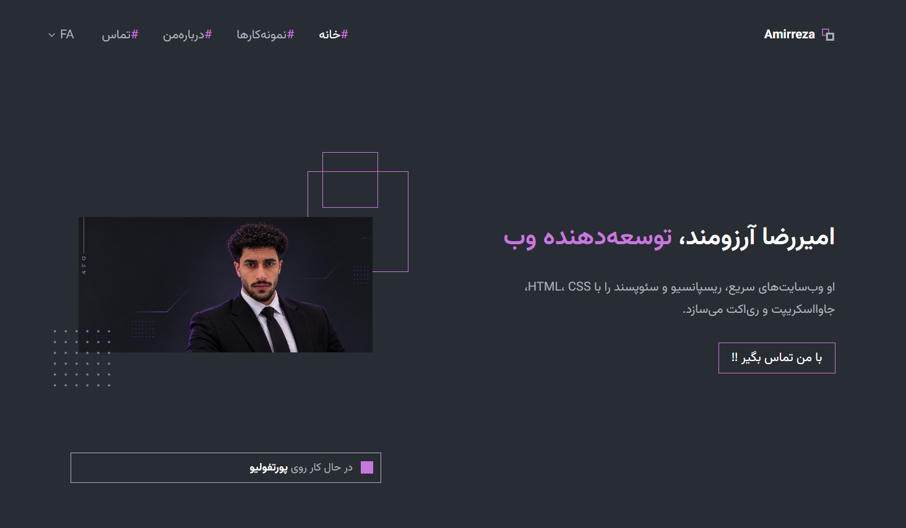

Live : https://mr-arez.github.io/Arez-portfolio

# Portfolio: Amirreza Arezoumand

Plain HTML, CSS and JavaScript. No build step. Layout and style follow the "Portfolio (Community)" Figma file.

## Structure

```
index.html  projects.html  about.html  contacts.html  404.html
css/style.css
js/i18n.js      EN / FA texts (add or edit translations here)
js/main.js      language switcher (RTL for FA), mobile menu, icons, contact form
assets/         logo, favicon, placeholder images (replace with real ones)
sitemap.xml  robots.txt  CNAME  .nojekyll
```

## Things to replace

1. **Contact form:** create a free form at formspree.io, then set `formEndpoint` at the top of `js/main.js`.
2. **Photo:** replace `assets/portrait-placeholder.svg` (or change the `src` in the HTML files).
3. **Projects:** edit the cards in `index.html` and `projects.html` (title key `proj.nameN`, tags, links) and the texts in `js/i18n.js`.
4. **About text and quote:** `about.p1`, `about.p2`, `quote.text`, `quote.author` in `js/i18n.js`.

## Language

The first visit uses the browser language (Persian browsers get FA, all others EN). The choice is remembered in `localStorage`.
Fonts: Fira Code (English), Vazirmatn (Persian), loaded from Google Fonts.

## Deploy on GitHub Pages with arezcompany.ir

1. Create a repository, push all files to the root of the `main` branch.
2. Repository Settings → Pages → Source: `main` / root. Custom domain: `arezcompany.ir` (the `CNAME` file already contains it). Enable "Enforce HTTPS" once the certificate is ready.
3. At your domain's DNS panel add:
   - four `A` records for `@` pointing to `185.199.108.153`, `185.199.109.153`, `185.199.110.153`, `185.199.111.153`
   - a `CNAME` record for `www` pointing to `<your-github-username>.github.io`
4. DNS can take from a few minutes to a day. Check the current GitHub Pages IPs in GitHub's docs if something does not resolve.

## Local preview

Open `index.html` in a browser, or run `python3 -m http.server` in this folder.
